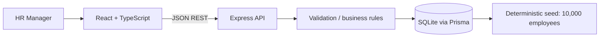

# Architecture and Design Notes

## Data model
- `Employee`: unique employee number/email, name, department, country, hire date, status.
- `Salary`: employee relation, integer amount in minor units, currency, effective date, created timestamp.
- A salary change creates a new `Salary` row. Current salary is the latest effective record.

## API boundaries
The browser never connects directly to SQLite. The API owns validation, pagination and aggregation. List endpoints return `{ data, pagination }`. Errors return a stable `{ error }` payload.

## Performance
- Database-side filtering, sorting and pagination; default page size 25, maximum 100.
- Index employee number, email, department, country and salary foreign key/effective date.
- Aggregate dashboard data in SQL through Prisma group-by where practical.
- Avoid a single cross-currency total. Return aggregates grouped by currency.

## Trade-offs
- SQLite minimizes setup and is adequate for a single-instance assessment. For production horizontal scaling/concurrent writes, PostgreSQL is preferred.
- Prisma improves type safety and schema evolution. Raw SQL may be introduced for more complex analytics after profiling.
- No auth is implemented because no identity provider or authorization matrix was specified. This is a documented production blocker, not a claim that the demo is secure for real compensation data.
